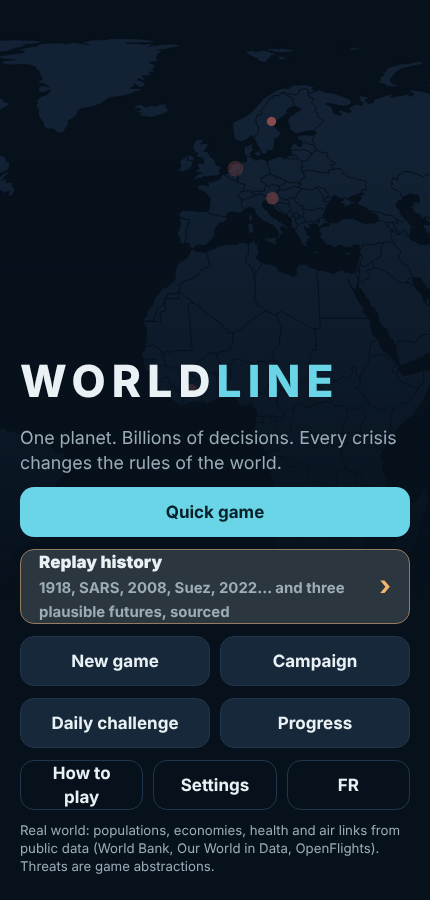

# WORLDLINE

Simulateur stratégique mondial, pensé d'abord pour le téléphone : une planète, des milliards de décisions, chaque crise redistribue les règles.

## Fonctionnalités

- Partie rapide, campagne, défi quotidien et progression
- Rejouer l'histoire : 1918, SRAS, 2008, Suez, 2022, et trois futurs plausibles documentés
- Monde construit sur des données publiques réelles : populations, économies, santé, liaisons aériennes (Banque mondiale, Our World in Data, OpenFlights)
- Interface bilingue français / anglais, sauvegarde locale des parties

## Lancer

Ouvrir `index.html` dans un navigateur récent. Aucune installation, aucun réseau requis.

## Technique

React, TypeScript, Vite et Zustand, compilés en un seul fichier HTML autonome. Ce dépôt publie la version compilée ; les sources ne sont pas incluses.

## Statut

Jouable, en développement actif (modes et profondeur de jeu).

## Droits

© 2026 Florian Iglesias – Tous droits réservés. Code publié à titre de présentation : aucune licence d'utilisation, de copie ou de redistribution n'est accordée.
