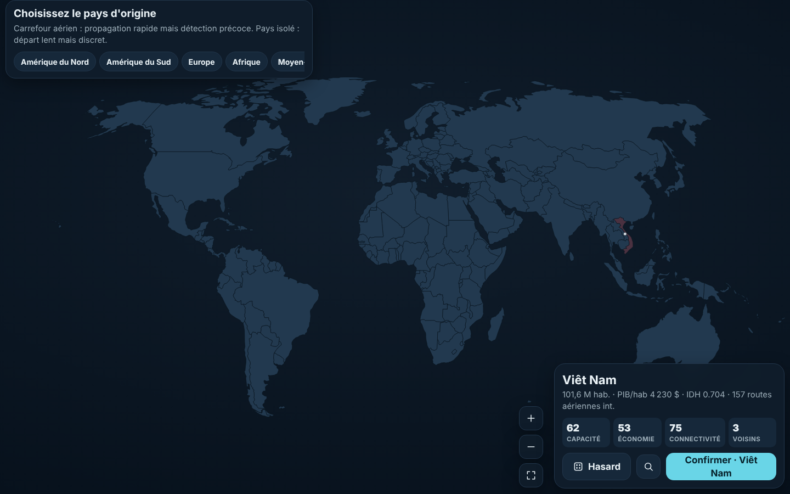
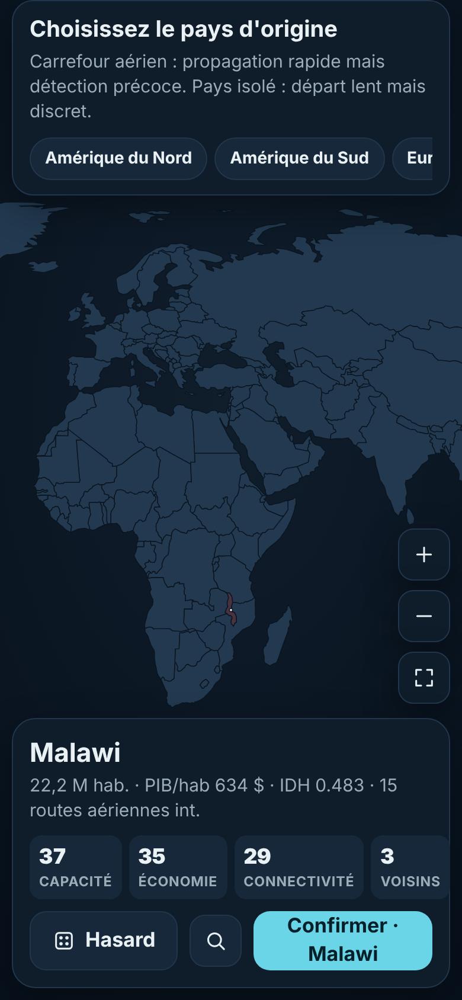

# WORLDLINE — une planète, des milliards de décisions

[](https://github.com/Skysaks/WORLDLINE/actions/workflows/ci.yml)

> **EN** — A mobile-first global strategy game: 176 real countries built from public data (population, wealth, health, age, air routes), crises that spread along borders and real flight paths with the seasons, and historical replays (1918, SARS, 2008, Suez, 2022…) whose figures are sourced. French and English.

**Jouer** : [skysaks.github.io/WORLDLINE](https://skysaks.github.io/WORLDLINE/) · fichier autonome : [`dist/worldline.html`](dist/worldline.html) (à télécharger et ouvrir, hors ligne, sans installation).



> © 2026 Florian Iglesias — Tous droits réservés. Dépôt public à titre de portfolio uniquement : aucune licence n'est concédée. Voir [LICENSE](LICENSE).

## Le principe

Une crise — épidémie, choc financier, catastrophe climatique, vague de désinformation — part d'un pays et se propage par les frontières terrestres et les routes aériennes réelles. Un carrefour aérien propage vite mais détecte tôt ; un pays isolé démarre lentement mais discrètement. Le calendrier est réel : l'hiver de chaque hémisphère accélère la propagation, l'été amplifie les chocs climatiques. Chaque décision (mesures, communication, coopération entre pays) change la suite.

## Modes de jeu

- **Partie rapide** et **nouvelle partie** paramétrable (type de menace, pays d'origine, réglages avancés).
- **Rejouer l'histoire** : grippe de 1918, SRAS 2002–2003, canicule de 2003, krach de 2008, nuage de cendres de 2010, canal de Suez 2021, inondations de 2022… avec les chiffres réels cités et leurs sources (OMS, CDC, Banque mondiale, Britannica…), et des futurs plausibles documentés.
- **Campagne** « Le siècle instable », **défi du jour** (scores conservés sur l'appareil), **progression**.
- **Face-à-face asymétrique** : jouer la coalition des pays, ou l'entité qui cherche à rester cachée le plus longtemps.

| Ordinateur | Téléphone |
|---|---|
|  |  |

## Données

Les 176 pays sont construits à partir de données publiques — Banque mondiale (population, PIB), Our World in Data, OpenFlights (liaisons aériennes internationales) — et les menaces restent des abstractions de jeu. Les scénarios historiques citent leurs sources dans l'interface.

## Ce que contient ce dépôt

Ce dépôt publie la **version construite** du jeu : un fichier HTML unique de ≈ 710 Ko (bundle Vite minifié, React et Zustand inclus), autonome et hors ligne. Les sources TypeScript ne sont pas publiées. Autour du fichier, le dépôt apporte la même chaîne de vérification que les autres projets : contrôles d'intégrité, absence de toute ressource externe, parcours de bout en bout sur bureau et téléphone, publication automatique.

```bash
npm ci
npm run dev        # http://localhost:5173
npm run verify     # aucune ressource externe, budget de taille, aucune donnée personnelle
npm test           # tests d'intégrité (node:test) + parcours bureau et mobile (Playwright)
npm run captures   # régénère docs/captures/
```

## Structure du dépôt

```
dist/worldline.html   le jeu, fichier unique autonome (≈ 710 Ko)
scripts/              vérification, serveur local, captures, site GitHub Pages
tests/                intégrité (node:test) et parcours de bout en bout (Playwright)
docs/                 architecture, captures
```

## Choix techniques

- **React + TypeScript + Zustand, compilés par Vite en un seul fichier** : une partie se lance depuis un lien, une pièce jointe ou un téléphone hors connexion.
- **Pensé d'abord pour le téléphone** : carte plein écran, fiches pays repliables, commandes au pouce.
- **Sauvegarde locale** : parties, progression et défis restent dans le navigateur (`localStorage`).

## Limites connues

1. **Sources non publiées** : le dépôt ne permet pas de reconstruire le bundle ; il permet de le vérifier et de le tester.
2. **Modèle de jeu, pas un modèle épidémiologique** : les règles de propagation sont des abstractions calibrées pour le jeu.
3. **Tests automatiques sur Chromium** (bureau et mobile émulé) ; Safari et Firefox ne sont pas couverts par la CI.

## Sécurité et confidentialité

Aucune requête réseau, aucun compte, aucune donnée personnelle : tout reste sur l'appareil. Signalement des failles : [SECURITY.md](SECURITY.md).

## Licence

© 2026 Florian Iglesias — Tous droits réservés ([LICENSE](LICENSE)). Les bibliothèques incluses dans le bundle (React, Zustand) restent sous licence MIT. Contributions : [CONTRIBUTING.md](CONTRIBUTING.md).
